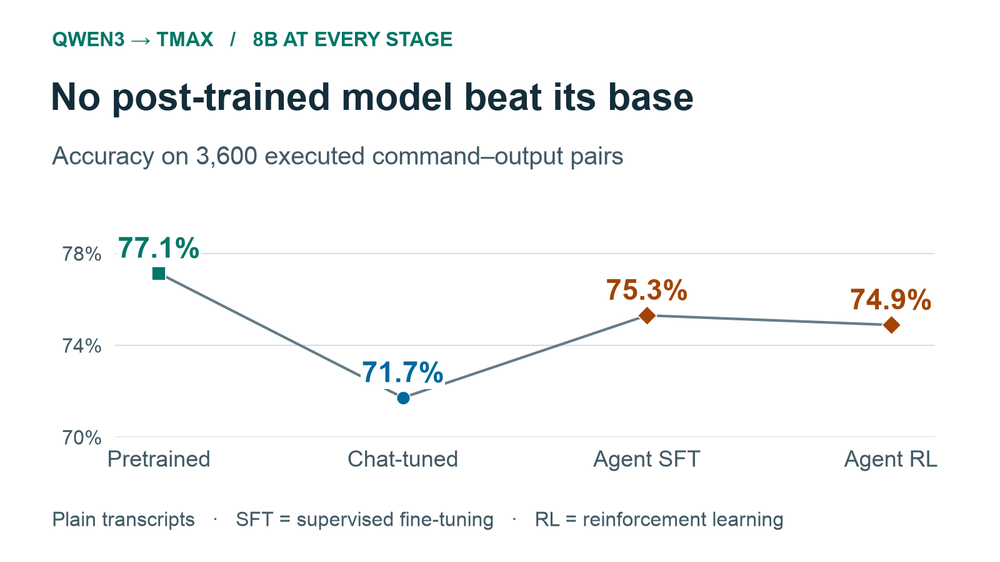
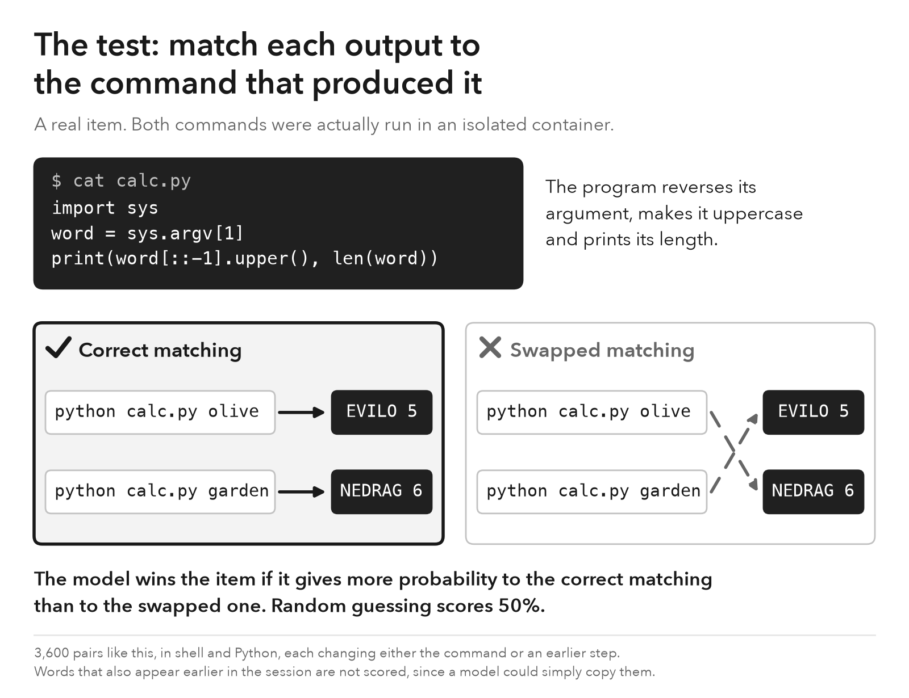
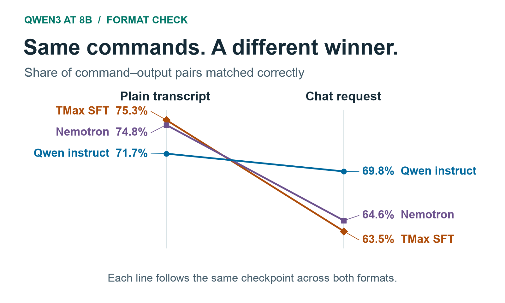

# Do agentic LLMs learn world models of their tools?

When a shell command changes, can a language model anticipate how the reply will change? We measured that ability in Qwen3 before chat tuning, after chat tuning, and after further training for tool use. **Pretraining built the strongest predictor of tool output in this family.** Several agent checkpoints recovered ground lost during chat tuning. None clearly surpassed an available same-size pretrained base on the primary sandbox measure.

At 8B, the pretrained model matched **77.1%** of executed output pairs to their histories. Chat tuning brought that down to **71.7%**. Supervised terminal training with TMax recovered **75.3%**. TMax’s next RL step raised its reported TB-Lite task score from **11.5 to 17.7**, while its binding score changed by **−0.4 percentage points**. Predicting a tool’s response and choosing a productive next action can move independently. [Article](writeups/article/ARTICLE.md) · [Independent review](writeups/REVIEW.md) · [Checkpoint lineage](writeups/SWE_CONTROLS.md)



## What the model has to predict

Each sandbox item contains two minimally different commands or prior states and the outputs produced by executing both. We score each output under each history. The item counts as correct when the sum of the two matched log probabilities exceeds the crossed sum. A tie earns half credit. A model that simply prefers one output under both histories gains nothing. We mask copied words, score at temperature one, and average over the 3,600 primary pairs. The archive also contains 600 control pairs. [Executed items](sandbox/items.jsonl.gz) · [Scoring definition](sandbox/score2x2.py) · [Benchmark design](sandbox/README.md)



### Binding on plain transcripts

| Qwen3 size | 0.6B | 1.7B | 4B | 8B | 14B | 32B |
|---|---:|---:|---:|---:|---:|---:|
| Pretrained base, % | 63.6 | 68.6 | 75.7 | 77.1 | 78.4 | — |
| Instruct, % | 60.4 | 64.6 | 68.7 | 71.7 | 75.3 | 79.3 |

Every instruct size step improves on the combined primary pool. On the base ladder, the individual steps above 4B have paired intervals that include zero. The 4B base already matches 14B instruct within sampling uncertainty. Qwen did not release a 32B base. [Ladder results](sandbox/results/size_equiv/size_equiv_plain_nocopy_T1.md) · [Validation and sample extension](writeups/SANDBOX_VALIDATION.md)

### How much each fine-tune gains

Differences are percentage points on the same primary pairs. The first column of differences uses same-size Qwen3 instruct as a common reference. The start column uses the immediate parent where documented. For Nemotron and WebWorld the start is uncertain, so the table labels the instruct comparison as a reference. Klear starts from base. TMax RL starts from TMax SFT. [Paired comparisons](writeups/SANDBOX_SIZE_EQUIV.md) · [Model provenance](writeups/SWE_CONTROLS.md)

| Checkpoint | Δ vs instruct | Δ vs start or reference | Δ vs base |
|---|---:|---:|---:|
| Nemotron-Terminal-8B | +3.1 | +3.1 ref. | −2.4 |
| TMax SFT 8B | +3.6 | +3.6 | −1.8 |
| TMax RL 8B | +3.2 | −0.4 | −2.2 |
| SERA-8B | +1.4 | +1.4 | −4.1 |
| Arctic-AWM-8B | −0.2 | −0.2 ref. | −5.7 |
| Nemotron-Terminal-14B | +3.4 | +3.4 ref. | +0.3 |
| CodeScout-14B | −0.2 | −0.2 | −3.3 |
| FrogMini-14B | +0.6 | +0.6 | −2.5 |
| Nemotron-Terminal-32B | +2.9 | +2.9 ref. | — |
| OpenThinkerAgent-32B | −0.5 | −0.5 | — |
| Light-IF-8B | +1.5 | +1.5 | −3.9 |
| Light-IF-14B | +1.7 | +1.7 | −1.4 |
| Klear-Reasoner-8B-SFT | −3.5 | −8.9 | −8.9 |
| WebWorld-8B | −0.1 | −0.1 ref. | −5.5 |

Five of ten agent checkpoints gained on plain binding relative to instruct. Nemotron-14B’s +0.3 over base was statistically indistinguishable from zero. Light-IF, a non-agentic instruction-following control, also improved over instruct. The final four rows are controls. OpenThinker-Agent-v1-SFT and SERA-14B were evaluated only on SWE.

### Change the rendering and the 8B ranking reverses

| Checkpoint | Plain binding, % | Chat binding, % |
|---|---:|---:|
| Qwen3-8B instruct | 71.7 | 69.8 |
| Nemotron-Terminal-8B | 74.8 | 64.6 |
| TMax SFT 8B | 75.3 | 63.5 |
| Qwen3-32B instruct | 79.3 | 76.6 |
| Nemotron-Terminal-32B | 82.2 | 75.8 |

The files, commands and outcomes are identical. In chat the model is asked to give the exact final output as the assistant. Both 8B specialists fall behind instruct. At 32B the chat difference is within uncertainty. Only these three specialists were scored in chat. [Independent item-level analysis](writeups/REVIEW.md)



## Does it transfer to real software engineering sessions?

We scored tool replies from 150 resolved SWE-rebench trajectories from five teachers. Calibration and evaluation use separate tasks. M1 measures recalibrated code length on content tokens after filtering copied spans and boilerplate. A size multiplier is the instruct-model size that matches a checkpoint’s score, divided by its starting size, interpolated in log non-embedding parameters. A value below 1× means higher loss than the start. The Klear row uses the base ladder. Boundaries mark censored estimates. [Methods](writeups/SWE_FINDINGS.md) · [All metrics, intervals and interpolation limits](swe/results/size_equiv/size_equiv_swe.md)

| Checkpoint | SWE M1 size equivalent | Checkpoint | SWE M1 size equivalent |
|---|---:|---|---:|
| TMax SFT 8B | 1.31× | Nemotron-Terminal-14B | 0.82× |
| TMax RL 8B vs instruct | 1.04× | CodeScout-14B | 0.84× |
| TMax RL vs SFT alone | 0.79× | SERA-14B | <0.50× |
| Nemotron-Terminal-8B | 0.99× | FrogMini-14B | <0.50× |
| Arctic-AWM-8B | 1.01× | Nemotron-Terminal-32B | 0.81× |
| OpenThinker-Agent-v1-SFT | 0.56× | OpenThinkerAgent-32B | <0.50× |
| SERA-8B | <0.50× | Light-IF-14B | 0.82× |
| Light-IF-8B | 1.08× | Klear-Reasoner-8B-SFT | <0.50× |
| WebWorld-8B | 1.26× | | |

No counted specialist reached 2× on aggregate content. Seven of eleven scored significantly worse than their instruct reference. FrogMini’s custom rendering makes its large SWE loss hard to interpret, so it is shown separately from that count. Gains depend on the output type. Nemotron-8B saves about 0.049 bits per token on file views and loses 0.055 on test runs. The 14B base uses 0.987 bits per content token, ahead of 32B instruct at 1.016. [Per-output results](swe/results/size_equiv/kinds_swe.md)

## Terminal output, command confidence and AgenticPPL

On recorded terminal histories, Nemotron-8B assigns the teacher’s thoughts an extra 0.77 bits per token of log probability and its commands an extra 0.26, while the terminal replies lose 0.36. Raw output perplexity also charges models for guessing boilerplate and random strings. About 35% of the 8B base model’s neutral observation bits went to novel content under the study’s classification. [Role-by-role results](terminal/results/logratio.csv) · [Token classes](terminal/token_classes/neutral.md) · [Terminal findings](writeups/TERMINAL_FINDINGS.md)

AgenticPPL scores selected commands whose tokens are easier to predict after reading earlier output. Across 20 checkpoints the default score’s Spearman correlation with command-token entropy was **−0.77**. At 8B, chat tuning improves the capped score while increasing the uncapped cost of the same selected spans. Nemotron improves both. [Per-checkpoint and correlation tables](agenticppl/results/m5_tables.md) · [Reference-engine validation](agenticppl/results/m5_validate)

| 8B checkpoint | AgenticPPL, default ↑ | Uncapped bits per picked span ↓ | Command entropy, bits/token |
|---|---:|---:|---:|
| Qwen3 base | −0.929 | 1.807 | 0.415 |
| Qwen3 instruct | −0.827 | 3.224 | 0.189 |
| Nemotron-Terminal | −0.773 | 1.441 | 0.288 |

This panel helps explain how confidence enters the metric. It lacks uniform live task scores for retesting the original held-out ranking result. [Wenhao Chai’s AgenticPPL](https://wenhaochai.com/blogs/agentic-ppl.html)

## Scope of the evidence

- These are behavioral tests in one model family. They do not identify an internal representation or establish that it causes task success. Most training recipes leave observation loss masks unspecified.
- The initial sandbox gate narrowly missed the 8B→14B step. The authors then generated an independent extension from the same grammar. The extension and combined results are available separately. Exact shell and Python outputs cover only part of real tool use. [Validation](writeups/SANDBOX_VALIDATION.md)
- SWE includes unobserved repository contents, repeated tasks across teachers and only successful runs. Intervals resample trajectories, so uncertainty across tasks may be larger. Substituted SWE commands were scored without executing them. The sandbox provides the executed counterfactuals.
- Plain, native and chat renderings put different demands on the same model. Agent scores from different papers also use different harnesses. The cleanest RL comparison is TMax against its own SFT parent.

## Reproduce the study

**Check the released scores on CPU** from the repository root. The first command needs only Python’s standard library. It verifies item IDs and strata for every model/render run, recomputes all six stored metrics in every stratum and the primary pool, and compares them with the original summaries. It prints the base, instruct and chat comparisons.

```bash
python3 sandbox/check_binding.py
python3 sandbox/inspect_items.py --n 2 --seed 7
```

**Rerun model scoring** on Linux. Budget roughly **25 GPU-hours on one 96 GB GPU** for the original study. Downloads, preprocessing, engine settings and hardware affect elapsed time. The scoring environment used Python 3.10, CUDA 12.8, PyTorch and Hugging Face Transformers with bfloat16. The packaged sandbox items are ready to score. Rebuilding them from execution also requires rootless Podman. Configure a CUDA-enabled PyTorch build compatible with your driver.

```bash
python3.10 -m venv .venv
source .venv/bin/activate
pip install torch==2.11.0 --index-url https://download.pytorch.org/whl/cu128
pip install -r requirements.txt

# Terminal and AgenticPPL inputs, including the upstream pick sets
hf download wchai/AgenticPPL --repo-type dataset \
  --revision 7768b574e0efdced30de307f540aa5d9c39c0ac1 --local-dir terminal/data

# SWE leaderboard input and deterministic sample construction
python swe/data/fetch.py
python swe/data/build.py lb
```

Run one checkpoint with any of the commands below. The model argument is a Hub ID or a local model directory named for the checkpoint. Each runner writes new results under its own `runs/` directory and uses the normal Hugging Face cache for weights. SWE checks the rendered token IDs before scoring.

```bash
sandbox/run_model.sh Qwen/Qwen3-8B plain,chat
swe/run.sh Qwen/Qwen3-8B
terminal/run.sh Qwen/Qwen3-8B
agenticppl/run_m5.sh Qwen/Qwen3-8B
```

For the full published panels, run the following after input preparation. The manifest records which checkpoints and renderings were actually scored in each study. Recomputing every checkpoint requires space for downloaded weights and generated token arrays. [Panel manifest](models.tsv)

```bash
./run_panel.sh sandbox
./run_panel.sh swe
./run_panel.sh terminal
./run_panel.sh agenticppl

python sandbox/compact_results.py sandbox/runs sandbox/runs/binding.csv.gz
(cd swe && P2_WORK=work P2_RAW=runs python size_equiv.py --ds swe --B 1000 --out runs/size_equiv)
(cd terminal && python analyze.py runs > runs/tables.md && python copytest_report.py runs && python logratio.py tok runs)
python agenticppl/m5_table.py agenticppl/runs
```

To rebuild the synthetic pairs, run `sandbox/rebuild.sh`. It creates the original batch, the hard strata and the deduplicated extension under `sandbox/runs/items/`. For the secondary SWE-smith and OpenHands builds, use `python swe/data/fetch.py --all` followed by `python swe/data/build.py`.

**Release contents and limits.** The compact sandbox CSV retains full-precision binding, interaction bits/byte and per-item information gain for both T=1 masks. Three full chat JSONL files and all checkpoint summaries preserve examples of the richer scorer output. For most models fresh forward passes are needed for alternative temperatures, strict masks, per-item nulls and token-level analyses. SWE bootstrap intervals and paired AgenticPPL range intervals require regenerated intermediates. The terminal size-equivalence supplement includes the analysis and original results, but the original pilot class-label arrays are unavailable here. The article figures are distributed as PNGs. The cover generator is included and runs with NumPy and Matplotlib. The original plotting code for the other figures, exact weight revisions and an immutable container image were unavailable for the release. This repository evaluates published weights and does not contain model training runs or live benchmark evaluations.

## Credits, licenses and citation

Wenhao Chai’s AgenticPPL motivated the distinction between scoring selected commands and predicting terminal output. Jakub Pachocki’s “Perplexity and Intelligence” motivated the comparison across pretraining and post-training. [AgenticPPL](https://wenhaochai.com/blogs/agentic-ppl.html) · [Perplexity and Intelligence](https://openai.com/index/perplexity-and-intelligence/)

The recorded data come from Wenhao Chai, LegoX, Terminal Wrench, Nebius SWE-rebench and SWE-smith. The checkpoint panel credits Qwen, NVIDIA, Ai2, OpenHands, OpenThoughts, Snowflake, Microsoft, Qihoo 360 and Kwai-Klear. Author code and generated sandbox pairs are MIT. AgenticPPL, Terminal-Lego and terminal-wrench derivatives retain Apache-2.0, SWE-rebench leaderboard derivatives retain CC-BY-4.0, and SWE-smith derivatives retain MIT. Model terms include Apache-2.0, MIT and the NVIDIA Open Model License. Every evaluated checkpoint and upstream data source is linked in the license inventory. [Data and model licenses](DATA_LICENSES.md) · [MIT license](LICENSE)

```bibtex
@misc{li2026agenticworldmodels,
  author = {Bojie Li},
  title = {Do agentic LLMs learn world models of their tools?},
  year = {2026},
  url = {https://github.com/bojieli/agentic-world-models}
}
```
