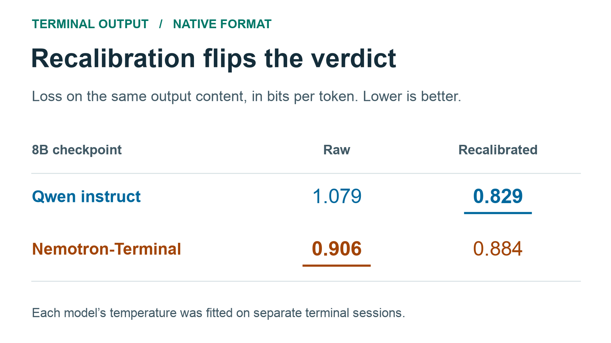
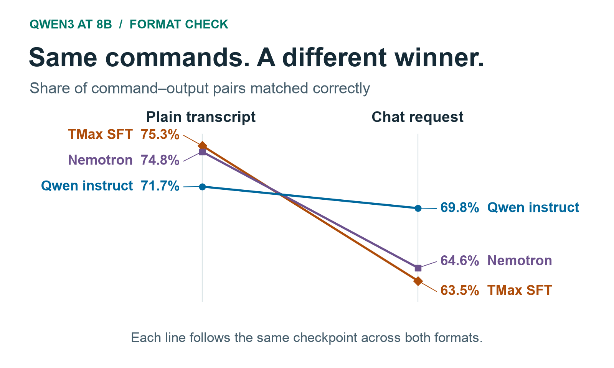

# Pretraining builds the tool-output world model that agent tuning uses

OpenAI’s Jakub Pachocki reports that base-model perplexity tracks capabilities as different as holding a conversation and doing original math. Wenhao Chai found a twist in terminal sessions. The models that predicted the terminal’s replies best tended to rank *lower* as agents, yet scoring selected commands predicted agent rank remarkably well.

If perplexity tracks intelligence, can it tell us whether an agent understands its tools? We paused coding sessions just before the shell replied and compared models at different stages of training. **At 8B, the best forecast came from the model that had never been trained to be an agent.** Chat tuning cost it ground. Supervised agent training recovered some. Reinforcement learning raised the agent’s task score while leaving its forecasts about where they were.

## Which side of the terminal are you scoring?

On November 22, 2026, Pachocki published base-model log-perplexity on a held-out snapshot of OpenAI’s internal code. The figures in his post put fluent conversation around 0.99, productive chain-of-thought reasoning around 0.91 and breakthrough math results around 0.76. Lower means the model assigned more probability to the text that actually came next. Pachocki also points out that using chain-of-thought can improve what a model achieves without lowering its base-model perplexity. [OpenAI’s “Perplexity and Intelligence”](https://openai.com/index/perplexity-and-intelligence/)

Chai’s AgenticPPL takes advantage of a detail about agents. Suppose a directory listing reveals a filename and the agent uses it in the next command. Seeing the listing makes the filename easier to predict. Chai used a reference model to find command tokens like that. Scoring them gave a rank correlation of +0.79 on held-out models. Scoring the terminal’s own output ranked agents in the opposite direction (−0.37). [Wenhao Chai’s AgenticPPL](https://wenhaochai.com/blogs/agentic-ppl.html)

The filename example gave us a way to turn Chai’s question around. After seeing the listing, can the agent choose which file to open? Now pause *before* the listing appears. Given the preceding commands, can the model anticipate which files are there? That second ability is what we mean here by a tool-output world model.

## How much of perplexity is confidence?

Pretraining rewards a model for putting probability on the next token. On our terminal sessions, the pretrained Qwen3 models did best at their default temperature of 1.0. The chat-tuned releases, which we call *instruct*, made overconfident bets. On separate calibration sessions, their best temperatures ranged from 1.2 to 1.8. Raising temperature spreads the bets out while preserving the model’s ranking of possible next tokens. That adjustment alone closed about half the gap between base and instruct.

What gets counted matters, too. For the 8B base model, only about **35% of the bits of surprise** in terminal output came from what we counted as content. Random strings such as hashes and timestamps accounted for about 31%, and boilerplate from the test harness another 21%. Guessing an opaque hash can cost a model dearly even when it correctly anticipates the error message wrapped around it.

Consider NVIDIA’s Nemotron-Terminal at 8B. We kept the terminal’s native format and scored the content of the replies. On raw probabilities the specialist beat Qwen instruct. We then fitted each model’s temperature on separate sessions and scored the same replies again. **Instruct won.** Neither model had seen another training example. What changed was how heavily the score punished a confident miss.

Confidence also helps explain Chai’s command score. Across our 20 checkpoints, AgenticPPL rose as uncertainty about commands fell (rank correlation with entropy, −0.77). At 8B, chat tuning improved the capped score from −0.929 to −0.827. Remove the cap on the cost of a miss, and the same selected command spans got *more* expensive to predict, from 1.81 to 3.22 bits per span. AgenticPPL can pick up something valuable about taking the next action. To measure what an agent expects the machine to do, we need the machine’s answer.

## What the base model already knows

We started with two kinds of recorded sessions. On ordinary terminal transcripts, we measured how many bits the model needed per byte of actual output. Across the pretrained Qwen3 checkpoints from 0.6B to 14B, that cost fell from 0.170 to 0.108. Every size step helped.

Then we replayed 150 successful software-engineering runs from five models on SWE-rebench. Here a tool might return a chunk of source code or the result of a test. We filtered out copied spans and boilerplate and recalibrated on separate tasks. The base models again improved at every size step, from 1.517 to 0.987 bits per content token. **Even the 32B instruct model, at 1.016, needed more bits than the 14B base.**

A repository can contain files the agent has never opened. The next word in one of those files makes an awkward test of whether a model understood the last command. So we built a sandbox where we could change one thing, run both versions and see exactly which answer went with which history.

The answer is EVILO 5. Change the argument to “garden” and you get NEDRAG 6. Both answers look like this program’s output. We built 3,600 pairs in a shell and Python sandbox, changing either the command or an earlier state, and executed both versions. We scored whether the model assigned more probability to the two correct pairings together than to the crossed pairings. A general preference for one answer cancels out. We excluded copied words from the score. Chance is 50%.

On these plain transcripts, pretrained accuracy climbed from 63.6% at 0.6B to 75.7% at 4B, then flattened toward 78.4% at 14B. The individual steps above 4B were too small to distinguish from noise. The 4B base was already neck and neck with 14B instruct at 75.3%. Across all three tests, the pretrained release beat the chat-tuned one at every size where we had both.

## How much does agent training buy back?

Ai2’s TMax gives us a training sequence we can follow. On the plain sandbox, supervised fine-tuning on terminal examples took 8B instruct from 71.7% to 75.3%. If your starting point was the chat model, that bought you the accuracy of 14B instruct. If your starting point was the 8B base, at 77.1%, the specialist still had ground to make up.

Across ten agent checkpoints, five gained roughly as much as one doubling in instruct-model size on this test. The other five showed no clear gain. None clearly beat an available same-size base. The closest call was Nemotron at 14B, whose point estimate was 0.3 percentage points above base, a statistical tie. Qwen did not release a 32B base for the largest comparison.

The gains were smaller in real repositories. Matching TMax’s supervised score on SWE tool replies would take an instruct model about 1.31 times its size, the best gain we saw. We got that multiplier by finding where the specialist’s loss landed between two sizes of instruct model.

Then TMax underwent reinforcement learning. Its reported TB-Lite task score climbed from **11.5 to 17.7**. On the sandbox the change was −0.4 percentage points, indistinguishable from zero. On SWE replies the 1.31× advantage shrank to 1.04×. The same training step made a more successful working agent while giving us no measurable improvement in its forecasts.

## Ask in chat and the lead changes hands

Keep the files, commands and outputs fixed. Put the transcript in a chat message and ask the assistant for the exact result of the final command. An independent review of the item scores caught what happened next.

TMax dropped from 75.3% to 63.5%. Nemotron dropped from 74.8% to 64.6%. Instruct slipped much less, from 71.7% to 69.8%, and finished ahead of both. The chat check covered three agent checkpoints. The third, Nemotron at 32B, was statistically level with its instruct counterpart. Even the direction of an apparent specialist advantage could depend on who the transcript asked the model to be.

## What the agent learned to write

On the original terminal sessions we could pause before any speaker’s turn. Given identical histories, Nemotron-8B assigned the recorded agent’s thoughts an extra 0.77 bits per token of log probability over instruct. Its commands picked up 0.26. The actual terminal reply lost 0.36.

That division of labor makes sense for a working agent. When a test fails, choosing the right diagnostic command is valuable even if the result surprises you. The shell supplies the result for free. Some training recipes make that distinction explicit. CodeScout, for instance, excluded tool replies from its training loss. Most labs disclose too little to say how much that mechanism explains across checkpoints.

Our evidence comes from one model family. Within Qwen3, pretraining built the most reliable predictor of what the tools would say. Post-training taught the agent how to act on what came back. The open question is which training recipe can improve both.

Try this in another family. Fork a real repository, change an earlier edit, and show each history to the model before running the same test in both copies. Score the first line that distinguishes the outcomes. Try it in plain text and in chat, then hide the edit and see whether the advantage disappears. **Can your agent beat its pretrained base when the answer depends on what changed?** Replicate with our code and data at [LINK]
