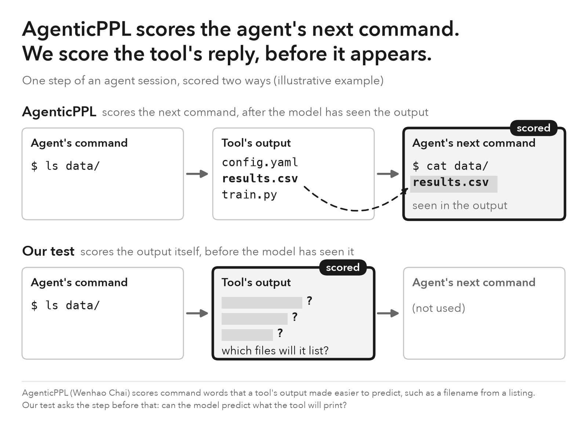
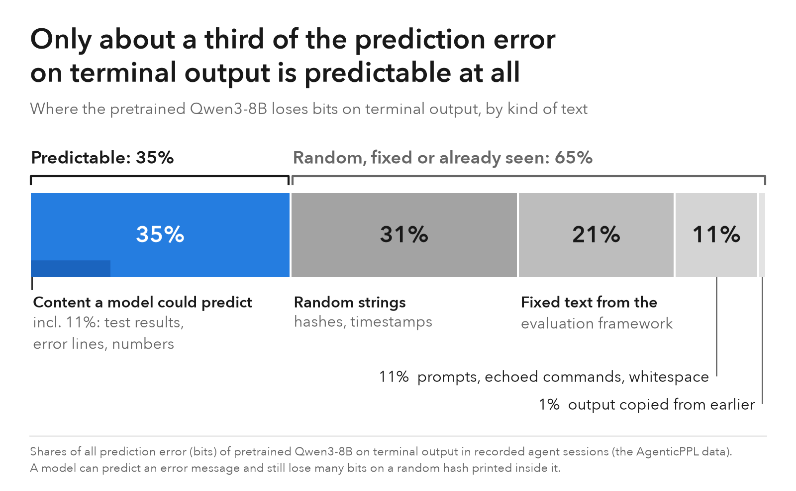
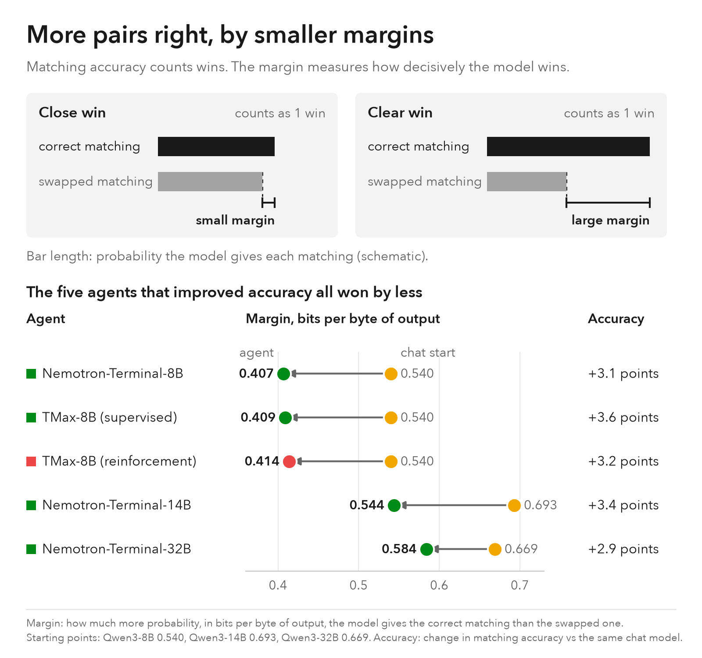

# Pretraining builds the world model of tool outputs. Agentic post-training doesn't.

OpenAI's chief scientist Jakub Pachocki reported that how well a pretrained model predicts text tracks what it can do, from holding a conversation to solving math problems. Wenhao Chai found something that seems to point the other way for agents: the models that best predicted the output of a terminal tended to rank lower on an agent benchmark.

That raises a question. Does training a model to act as an agent make it better at predicting what its tools will return? In this article, a "**world model of tool outputs**" means exactly that: the ability to predict what a command will print before it runs.

**We tested 14 publicly released models that other teams fine-tuned from Alibaba's open Qwen3 models. None of them predicted tool outputs better than the pretrained Qwen3 model of the same size.** This held at every size for which Qwen released a pretrained version. Qwen's own chat versions scored 3 to 7 percentage points lower than the pretrained versions on our main test.

Fine-tuning for agent work recovered part of that loss, but never more. The best agent model, NVIDIA's Nemotron-Terminal-14B, scored the same as the pretrained 14B model. Meanwhile, the teams behind these agents reported benchmark scores 1.6 to 8 times higher than their starting models. In Qwen3, the ability to predict tool outputs comes from pretraining. Agent training teaches the model to act on it.

## Agent perplexity scores the agent's commands, not the tool's replies

Perplexity measures how surprised a model is by real text: the more probability a model gives to the words that actually come next, the lower its perplexity. On November 22, 2026, Pachocki published the log-perplexity of OpenAI's pretrained models on a set of OpenAI's internal code that the models were not trained on. His chart marks fluent conversation at about 0.99, useful step-by-step reasoning at about 0.91, and breakthrough math results at about 0.76. Lower is better. He also notes that letting a model reason step by step can make it more capable without lowering this number. [OpenAI, "Perplexity and Intelligence"](https://openai.com/index/perplexity-and-intelligence/)

Chai's AgenticPPL applies perplexity to recorded agent sessions on terminal tasks. Suppose a directory listing shows a filename, and the agent then uses that filename in its next command. Having seen the listing, a model can predict that filename more easily. Chai used a reference model to find command tokens like this and scored each model on them. That score ordered models almost the same way Terminal-Bench, a benchmark of command-line tasks, did: a rank correlation of +0.79 on models not used to design the score. Scoring the terminal's own output instead gave a correlation of −0.37, the opposite order. [Wenhao Chai, AgenticPPL](https://wenhaochai.com/blogs/agentic-ppl.html)

AgenticPPL measures whether a model can use a tool's output after seeing it. We wanted to measure the step before that: before the directory listing appears, can the model predict which files it will show?

## Raw perplexity misreads post-trained models because they are overconfident

Pretraining trains a model to give accurate probabilities to the next piece of text. Qwen's pretrained models predicted our terminal sessions best at their default temperature of 1.0. Qwen's chat versions, which Qwen calls "instruct" models, were overconfident: on a separate set of sessions, their best temperature was between 1.2 and 1.8. Correcting the temperature alone closed about half of the difference between the pretrained and chat versions.

Much of a terminal's output cannot be predicted at all. For the 8B pretrained model, only about **35% of the prediction error** on terminal output came from content a model could in principle predict. About 31% came from random strings such as hashes and timestamps, and 21% from fixed text printed by the evaluation framework. A model can predict an error message correctly and still lose many bits on a random hash printed inside it.

This changes which model looks better. We compared NVIDIA's Nemotron-Terminal-8B, a Qwen3 model fine-tuned on recorded terminal agent sessions, with Qwen's 8B chat model on the content of terminal replies. With each model's probabilities used as they are, Nemotron-Terminal predicted the replies better. After we set each model's temperature on separate sessions and scored the same replies again, **the chat model predicted them better.** The only thing that changed was how heavily overconfident wrong predictions were penalized.

**Confidence** also explains part of AgenticPPL's result. Across the 20 models we scored, the more certain a model was about which command came next, the higher its AgenticPPL score (a rank correlation of −0.77 between the score and the model's uncertainty).

AgenticPPL also caps its penalties. It counts at most 2 bits for any single token, and at most 2 bits for any whole command span, however many tokens the span has. For scale, a token the model gave a 25% chance costs exactly 2 bits, and one it gave a 0.01% chance costs about 13 bits, but AgenticPPL counts both as 2. Chai added the cap for a good reason: without it, a single confident miss costing 10 to 40 bits can outweigh dozens of correct predictions, and in his tests the capped average tracked agent rank better than the uncapped one (rank correlation +0.89 against +0.68).

The side effect is that a model loses little when it is confidently wrong and keeps the full credit when it is right, so the cap rewards confident guessing. To measure whether a model can predict a tool's reply, we have to score the reply itself.

We ran into the same problem in an earlier study, [Incompressible Knowledge Probes (IKP)](https://01.me/research/ikp), which estimates a model's size from how many obscure facts it knows. Models differ in what they do when they don't know an answer. OpenAI's GPT-4.1 gave a wrong answer to 77% of IKP's hardest questions; Anthropic's Claude Opus 4.7 gave a wrong answer to 15% and said it did not know to most of the rest. How a wrong answer is scored decides which of them looks bigger. If a wrong answer costs nothing, GPT-4.1's guesses count in its favor, and IKP estimates it at 2.2 trillion parameters against 538 billion for Claude Opus 4.7. If a wrong answer costs 2 points, the order reverses: 1.3 trillion against 1.5 trillion.

Neither choice is neutral. **With no penalty, overconfident models gain from guessing. With a heavy penalty, cautious models gain from holding back, even on answers they could have given.** Perplexity is the heavy-penalty case: a confidently wrong token can cost any number of bits, which favors cautious models such as the pretrained ones. AgenticPPL's 2-bit cap moves toward the no-penalty case, which **favors confident ones such as the chat models**. Setting each model's temperature, as above, removes the difference in confidence so that the comparison measures what each model knows.

## Bigger pretrained models predict tool outputs better, and base beats chat

We first measured how many bits each model needed per byte of recorded terminal output. Across Qwen's pretrained models from 0.6 billion to 14 billion parameters, this fell from 0.170 to 0.108. Each step up in size improved it.

Next we took 150 successful coding sessions from SWE-rebench, a benchmark built from real GitHub issues, recorded by five frontier models. In these sessions a tool might return source code or the result of a test run. We ignored text the model could copy from earlier in the session and fixed boilerplate, and set each model's temperature on separate tasks. The pretrained models again improved with every step up in size, from 1.517 to 0.987 bits per token of content. **The pretrained 14B model predicted these replies better than the 32B chat model, which needed 1.016 bits per token.**

Real sessions have a limitation as a test: a tool often returns the contents of a file the model has never seen, which no model could predict. So we built a test in which every output can be worked out from what the model has already seen. Each item changes one thing and runs both versions for real, so we know which output belongs to which history.

The answer is EVILO 5. With "garden" the program prints NEDRAG 6. Both outputs look like something this program would print. We built 3,600 pairs like this in shell and Python, changing either the command or an earlier step, and executed both versions in an isolated container. For each pair, we checked whether the model gave more probability to the two correct matchings together than to the two swapped matchings. This cancels out any general preference for one of the outputs. We did not score words that also appeared earlier in the session, since a model could simply copy them. Random guessing scores 50%.

We call the share of pairs a model matched correctly its **matching accuracy**. On raw shell transcripts, the pretrained models' matching accuracy rose from 63.6% at 0.6B to 75.7% at 4B and 78.4% at 14B. The individual steps above 4B were too small to tell apart from noise. The pretrained 4B model scored about the same as the 14B chat model (75.7% vs 75.3%). On all three tests, the pretrained version beat the chat version at every size where both exist.

## Agent training wins back about one size doubling but never beats the base

Ai2 released two versions of its TMax-8B agent. The first was trained with supervised fine-tuning: training the model to imitate recorded agent sessions. The second added a reinforcement-learning stage: training the model on rewards for completing tasks. Supervised fine-tuning raised matching accuracy from 71.7% (Qwen's 8B chat model) to 75.3%, the same as Qwen's 14B chat model. The pretrained 8B model, before any chat training, already scored 77.1%.

Of the ten agent models we tested, five improved matching accuracy over their chat starting point by about as much as doubling the chat model's size would. The other five showed no clear improvement. Fine-tuning unrelated to agents also helped a little: Light-IF-8B, a Qihoo 360 model trained to follow complex instructions, gained 1.5 points.

Matching accuracy counts how often a model picks the correct matching. It does not measure how strongly the model prefers it. So we also measured the margin: how much more probability, in bits per byte of output, the model gave the correct matching than the swapped one. **All five agent models that improved matching accuracy had a smaller margin than the chat model they started from.** For Nemotron-Terminal-8B, the margin fell from 0.540 to 0.407 bits per byte. These models chose the correct matching more often, but with less difference between their probabilities for the correct and the swapped answer. Better knowledge of how the tool behaves should increase that difference, not reduce it.

**Nemotron-Terminal-14B came closest to beating the pretrained model of its size, and it scored the same.** On raw shell transcripts it scored 3.4 points above Qwen's 14B chat model. Compared with the pretrained 14B model, the difference was +0.3 points, with a 95% confidence interval from −1.1 to +1.9. A small difference in either direction is consistent with the data. Qwen did not release a pretrained 32B model, so Nemotron-Terminal-32B has no pretrained model of the same size to compare with.

The gains were smaller on the real coding sessions. After supervised fine-tuning, TMax-8B predicted tool replies about as well as a Qwen chat model 1.31 times its size would. That was the largest gain we found. After the reinforcement-learning stage, this fell to 1.04 times, and its matching accuracy changed by −0.4 points, which is within noise. Over the same stage, TMax-8B's reported score on Terminal-Bench Lite rose from **11.5 to 17.7**.

This pattern, a large gain on agent benchmarks with little or no gain in predicting tool output, holds for every agent model whose paper reports a score for its starting model.

## Asking the same question in chat format reverses the agents' advantage

So far, each model saw the session as a raw shell transcript. We then kept the files, commands and outputs the same, put the transcript inside the model's chat format, and asked the model for the exact output of the final command. An independent review of our raw results, done by OpenAI's GPT-6.2 Astra model with no access to our conclusions, first spotted the following.

TMax-8B fell from 75.3% to 63.5%. Nemotron-Terminal-8B fell from 74.8% to 64.6%. Qwen's chat model fell much less, from 71.7% to 69.8%, and scored higher than both.

We then ran the chat-format test on every fine-tuned model. **Five agent models scored above their chat starting point on raw transcripts. In chat format, four of them scored below it, and the fifth scored the same.** The largest change was Nemotron-Terminal-14B: 3.4 points above the chat model on raw transcripts, 10.3 points below it in chat format. Its tie with the pretrained 14B model was therefore a raw-transcript result.

This was not limited to agent models. Light-IF-14B, which had no agent training, went from 1.7 points above the chat model to 4.3 points below it. What these fine-tuned models gained on our test depends on how the question is formatted. A test of tool-output prediction that uses only one prompt format may largely measure how familiar the model is with that format.

## Supervised agent training teaches the agent's lines, not the tool's replies

In a recorded session, we can measure how much probability a model gives to each part: the agent's reasoning, the agent's commands, and the terminal's replies. Given the same sessions, Nemotron-Terminal-8B gave the recorded agent's reasoning 0.77 bits per token more probability than Qwen's 8B chat model did, and the agent's commands 0.26 bits more. It gave the terminal's actual replies 0.36 bits per token less.

The same pattern appears in Nemotron-Terminal-14B and 32B and in Ai2's SERA-8B. All four were fine-tuned on complete recorded agent sessions. It does not appear in the agents trained mainly with reinforcement learning (Snowflake's Arctic-AWM-8B, OpenHands' CodeScout-14B, and the reinforcement-learning stage of TMax-8B). It also does not appear in the fine-tuned models without agent training: none of them shifted probability away from tool output toward the agent's reasoning and commands. **Supervised fine-tuning on agent sessions mostly teaches a model to write the agent's part of the session. Reinforcement learning does not add to this.**

This makes sense for a working agent. When a test fails, choosing a useful diagnostic command matters even if the model cannot predict the result, because running the command shows the result.

## Limitations

Our tests cover one model family, a shell and Python test set, and a sample of successful coding sessions. The cost of chat training may be specific to Qwen3: in the one pair of Qwen3.5 models we tested, at 0.8B, the pretrained and chat versions scored the same (63.6% vs 63.5%). We also did not finish testing a model trained specifically to predict tool outputs, which would show what a real gain looks like on this test. Within Qwen3, across the whole sequence from pretrained model to chat model to agent model, we found **no detectable gain over the pretrained model**.

## Conclusion

**In Qwen3, the ability to predict tool outputs comes from pretraining. Agent training teaches models to act on that ability. The agents complete more tasks, but they do not predict their tools' outputs better than the pretrained model they were built from.**

Code and data: https://github.com/bojieli/agentic-world-models
