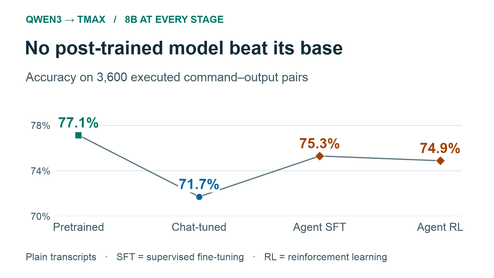
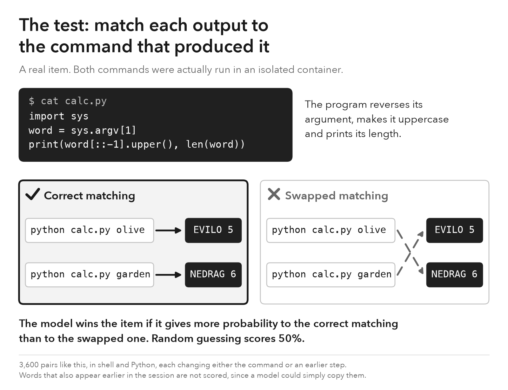
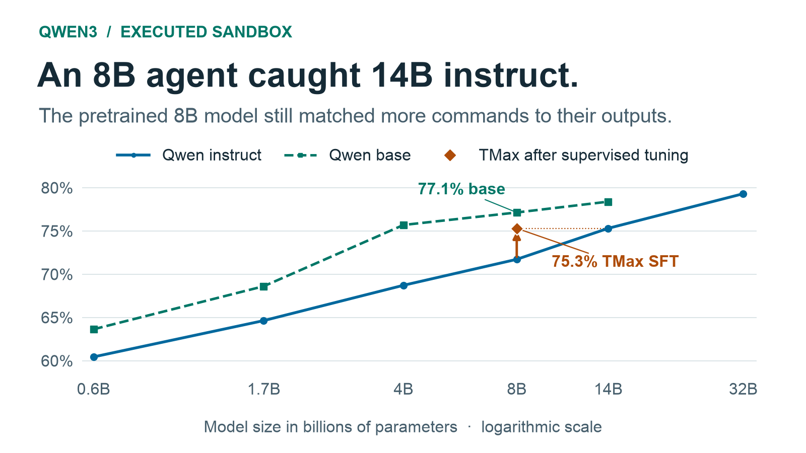
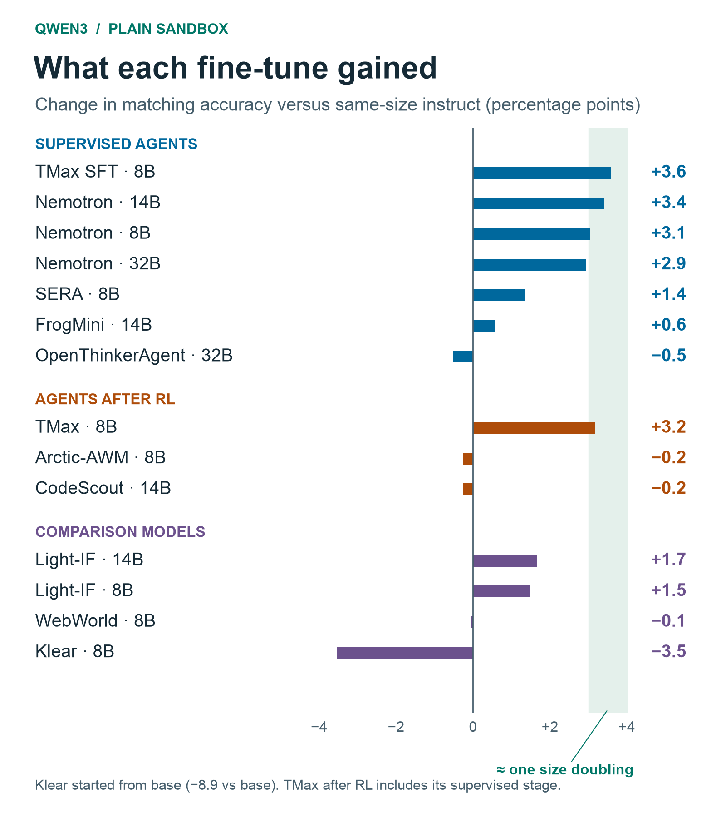
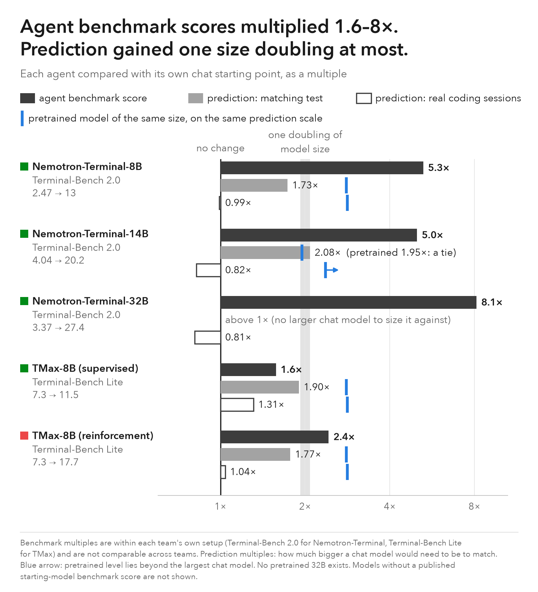
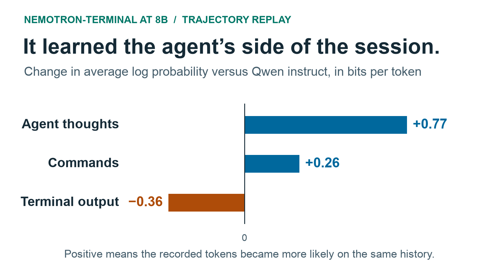

# Pretraining builds the world model of tool outputs. Agentic post-training doesn't.

OpenAI’s Jakub Pachocki found that base-model perplexity tracks capabilities from conversation to math. Wenhao Chai found that the models best at predicting a terminal’s replies tended to rank lower as agents. So when does a coding agent learn what its tools will do?

**No post-trained Qwen3 model we tested beat its own pretrained base at matching tool outputs to commands. That held at every size where we had both.** In Qwen3, chat tuning cost 3–7 percentage points. Agent training won some of it back, by thinner margins. Even Nemotron-14B, the strongest challenger, tied its base in plain text. Reinforcement learning raised one agent's reported task score from 11.5 to 17.7 and left its forecasts where they were. The teams reported roughly 2–8× higher success on agent benchmarks. Pretraining built the tool-output world model. Agent training taught the model how to act on it.

## Agent perplexity scores the agent's commands, not the tool's replies

On November 22, 2026, Pachocki published base-model log-perplexity on a held-out snapshot of OpenAI’s internal code. The figures in his post put fluent conversation around 0.99, productive chain-of-thought reasoning around 0.91 and breakthrough math results around 0.76. Lower means the model assigned more probability to the text that actually came next. Pachocki also points out that using chain-of-thought can improve what a model achieves without lowering its base-model perplexity. [OpenAI’s “Perplexity and Intelligence”](https://openai.com/index/perplexity-and-intelligence/)

Chai’s AgenticPPL inspired our test. Suppose a directory listing reveals a filename and the agent uses it in the next command. Seeing the listing makes the filename easier to predict. Chai used a reference model to find command tokens like that. Scoring them gave a rank correlation of +0.79 on held-out models. Scoring the terminal’s own output ranked agents in the opposite direction (−0.37). [Wenhao Chai’s AgenticPPL](https://wenhaochai.com/blogs/agentic-ppl.html)

Now pause *before* that listing appears. Given the preceding commands, can the model anticipate which files are there? That ability to anticipate the reply is what we mean here by a tool-output world model.

## Raw perplexity misreads post-trained models because they are overconfident

Pretraining rewards a model for putting probability on the next token. On our terminal sessions, the pretrained Qwen3 models did best at their default temperature of 1.0. The chat-tuned releases, which we call *instruct*, made overconfident bets. On separate calibration sessions, their best temperatures ranged from 1.2 to 1.8. Raising temperature spreads the bets out while preserving the model’s ranking of possible next tokens. That adjustment alone closed about half the gap between base and instruct.

For the 8B base model, only about **35% of the bits of surprise** in terminal output came from what we counted as content. Random strings such as hashes and timestamps accounted for about 31%, and boilerplate from the test harness another 21%. Guessing an opaque hash can cost a model dearly even when it correctly anticipates the error message wrapped around it.

Consider NVIDIA’s Nemotron-Terminal at 8B. We kept the terminal’s native format and scored the content of the replies. On raw probabilities the specialist beat Qwen instruct. We then fitted each model’s temperature on separate sessions and scored the same replies again. **Instruct won.** What changed was the cost of a confident miss.

Confidence also helps explain Chai’s command score. Across our 20 checkpoints, AgenticPPL rose as uncertainty about commands fell (rank correlation with entropy, −0.77). At 8B, chat tuning improved the capped score from −0.929 to −0.827. Remove the cap on the cost of a miss, and the same selected command spans got *more* expensive to predict, from 1.81 to 3.22 bits per span. AgenticPPL can pick up something valuable about taking the next action. To measure what an agent expects the machine to do, we need the machine’s answer.

## Bigger pretrained models predict tool outputs better, and base beats chat

We first measured how many bits each model needed per byte of recorded terminal output. Across the pretrained Qwen3 checkpoints from 0.6B to 14B, that cost fell from 0.170 to 0.108. Every size step helped.

Then we replayed 150 successful software-engineering runs from five models on SWE-rebench. Here a tool might return a chunk of source code or the result of a test. We filtered out copied spans and boilerplate and recalibrated on separate tasks. The base models again improved at every size step, from 1.517 to 0.987 bits per content token. **The 14B base predicted those replies better than 32B instruct, which still needed 1.016 bits per content token.**

A repository can contain files the agent has never opened. The next word in one of those files makes an awkward test of whether a model understood the last command. So we built a sandbox where we could change one thing, run both versions and see exactly which answer went with which history.

The answer is EVILO 5. Change the argument to “garden” and you get NEDRAG 6. Both answers look like this program’s output. We built 3,600 pairs in a shell and Python sandbox, changing either the command or an earlier state, and executed both versions. We scored whether the model assigned more probability to the two correct pairings together than to the crossed pairings. A general preference for one answer cancels out. We excluded copied words from the score. Chance is 50%.

We call the share of pairs matched correctly *binding accuracy*. On plain transcripts, pretrained accuracy climbed from 63.6% at 0.6B to 75.7% at 4B, then flattened toward 78.4% at 14B. The individual steps above 4B were too small to distinguish from noise. The 4B base was already neck and neck with 14B instruct at 75.3%. Across all three tests, the pretrained release beat the chat-tuned one at every size where we had both.

## Agent training wins back about one size doubling but never beats the base

Ai2 published TMax both before and after reinforcement learning. Supervised training on terminal examples took 8B instruct from 71.7% to 75.3% in the plain sandbox. That caught up with 14B instruct. Before chat tuning, the 8B base already scored 77.1%.

Five of the ten agent checkpoints gained roughly as much over the chat model as doubling its size. The other five showed no clear gain. Even training on ordinary instruction following bought back some accuracy. Light-IF gained 1.5 points at 8B without any terminal-agent training.

There's a catch in those gains. Binding accuracy only asks whether the model picks the right pairing. It doesn't ask how firmly. So we also measured the margin: how many bits separate the right pairing from the wrong one. **All five agents that gained on binding got worse on margin.** Nemotron-8B's margin shrank from 0.540 to 0.407 bits per byte. More pairs right, by thinner margins. That's not what a sharper picture of the machine looks like.

**Nemotron-Terminal-14B came closest to beating its base. It tied.** In plain transcripts it beat 14B instruct by 3.4 points. Against the pretrained 14B model, the difference was just +0.3 points (95% CI [−1.1, +1.9]). A small advantage in either direction fits the data. Qwen released no 32B base, so the larger specialist has no same-size base to beat.

The gains were smaller on real repository work. After supervised training, TMax predicted tool replies about as well as a chat model 1.31 times its size. That was the largest gain. Reinforcement learning shrank it to 1.04× and changed sandbox accuracy by −0.4 points, within the uncertainty. Over that same reinforcement step, TMax’s reported TB-Lite task score climbed from **11.5 to 17.7**.

That gap between doing and predicting shows up for every agent with a published starting score.

## Asking the same question in chat format reverses the agents' advantage

Keep the files, commands and outputs fixed. Put the transcript in a chat message and ask the assistant for the exact result of the final command. An independent review of the item scores caught what happened next.

TMax dropped from 75.3% to 63.5%. Nemotron dropped from 74.8% to 64.6%. Instruct slipped much less, from 71.7% to 69.8%, and finished ahead of both.

So we ran the chat test on every fine-tune. **Five agents beat their chat model in plain text. In chat, four fell behind it and the fifth only tied.** The biggest swing was Nemotron-14B: 3.4 points ahead in plain, 10.3 points behind in chat. Its tie with base was a plain-text result.

It isn't only agents. Light-IF-14B, an instruction-following fine-tune with no agent training, flipped from 1.7 points ahead to 4.3 behind. Whatever these fine-tunes picked up about tool outputs is tied to the wrapper. Ask in a different format and the ranking reverses. If you evaluate a world model in one prompt format, you may be measuring the format.

## Supervised agent training teaches the agent's lines, not the tool's replies

On the original terminal sessions we could pause before any speaker’s turn. Given identical histories, Nemotron-8B assigned the recorded agent’s thoughts an extra 0.77 bits per token of log probability over instruct. Its commands picked up 0.26. The actual terminal reply lost 0.36.

It isn't a one-off. Nemotron-14B and 32B show the same shift, and so does SERA-8B. All four were trained on full agent transcripts. The RL-trained agents don't show it. Neither do the non-agentic fine-tunes: none of them moved probability from tool output toward the agent's turns. **Supervised training on agent transcripts mostly teaches the agent’s lines. RL doesn’t add to them.**

That division of labor makes sense for a working agent. When a test fails, choosing the right diagnostic command is valuable even if the result surprises you. The shell supplies the result for free. Some training recipes make that distinction explicit. CodeScout, for instance, excluded tool replies from its training loss. Most labs disclose too little to say how much that mechanism explains across checkpoints.

## The limits, the bottom line, and a test for your own agent

Our tests cover one model family, a shell and Python sandbox, and a sample of successful repository runs. The chat-tuning cost may be a Qwen3 trait: in the one Qwen3.5 pair we ran, at 0.8B, base and instruct scored the same (63.6% vs 63.5%). And we didn't get to score a model trained specifically to predict tool output, which would show what a genuine gain looks like on this test. Within Qwen3, across the full chain from base to chat to agent, we saw **no detectable gain beyond base**.

**In this family, the world model comes from pretraining. Agent training taught the agents to act on it. They finished more tasks without seeing further ahead.**

Try it in another family. Fork a real repository, change an earlier edit, and run the same test in both copies. Give each model the two histories up to the test. Can it match the first line that differs to the edit that caused it? Try plain text and chat, then hide the edit and score again. Can your agent beat its base in both formats when it sees what changed? Code and data at https://github.com/bojieli/agentic-world-models
